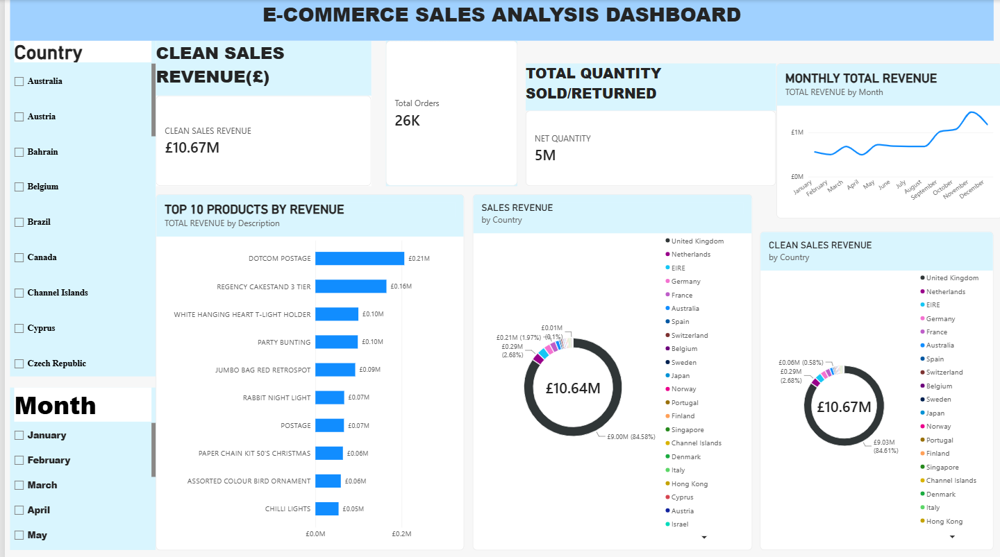

📊 E-Commerce Sales Analysis Dashboard

📌 Project Overview

This project focuses on analyzing e-commerce sales data to identify sales trends, revenue performance, and customer purchasing patterns.

The goal is to transform raw sales data into meaningful business insights using Microsoft Excel and Power BI.

🎯 Project Objectives

- Analyze overall sales performance.
- Identify revenue trends.
- Understand customer purchasing patterns.
- Perform data cleaning and preprocessing.
- Build an interactive Power BI dashboard.

🛠️ Tools & Technologies

- Microsoft Excel – Data Cleaning and Preparation
- Microsoft Power BI – Data Visualization and Dashboard Development

📂 Project Files

- "Ecommerce_Excel_Full_Data.xlsx" – Prepared Excel dataset (if included).
- "Ecommerce_Dashboard.pbix" – Power BI dashboard file.
- "Dashboard.png" – Final dashboard screenshot.

📈 Key Analysis

- Total Revenue
- Sales Trends
- Customer Analysis
- Product Performance
- Order Analysis

💡 Key Skills Demonstrated

- Data Cleaning
- Data Analysis
- Data Visualization
- Business Intelligence
- Dashboard Development

👩‍💻 Author

Aspiring Data Analyst

⭐ Project Purpose

Created as a portfolio project to demonstrate practical data analytics and Power BI dashboard development skills.

## Dashboard Preview

